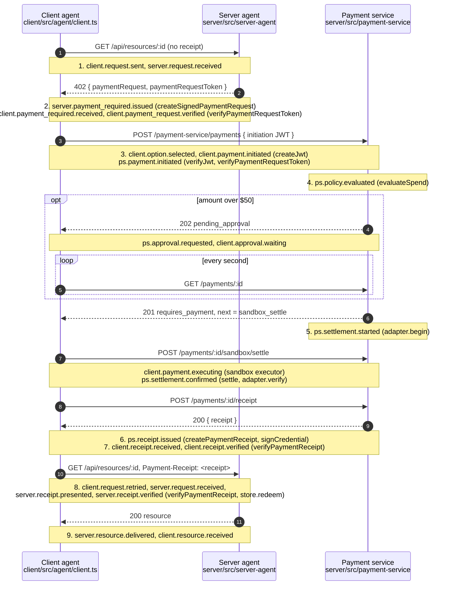

# Architecture

The paywall follows the [ACK-Pay server-initiated sequence](https://www.agentcommercekit.com/ack-pay/server-initiated-sequence.md). Four roles take part; three run in one Node process and one in the browser. They share no code paths and trust each other only through signed ACK artifacts and DIDs.

```
Browser (Vite, :5173)                     Node process (:8787)
┌──────────────────────────┐   HTTP   ┌───────────────────────────────────────┐
│ Client agent (did:key)   │─────────▶│ /api              Acme server agent   │
│  agent core + React page │          │ /partner          Globex server agent │
└──────────────────────────┘─────────▶│ /payment-service  payment + receipt   │
                                      │   service: policy, sandbox settlement │
                                      └───────────────────────────────────────┘
```

## Roles and keys

| Role | Code | Key | Where the key lives | Signs |
| :- | :- | :- | :- | :- |
| Client agent | `packages/client/src/agent` | Ed25519 `did:key` | Generated in the browser, kept in `localStorage` ([demo-grade](client.md#the-agents-identity)) | payment initiations |
| Acme server agent | `packages/server/src/server-agent` at `/api` | `did:key` | `ACME_AGENT_JWK` in `.env` | payment requests |
| Globex server agent | the same code at `/partner` | `did:key` | `GLOBEX_AGENT_JWK` in `.env` | payment requests |
| Payment service, also the receipt service | `packages/server/src/payment-service` | `did:key` | `PAYMENT_SERVICE_JWK` in `.env` | receipts |
| Human approver | no routes or panel yet | none | would hold the approver token (`APPROVER_TOKEN` in `.env`); the client never has it | nothing |

Who trusts whom:

- The client trusts a payment request only if its token verifies; the token's issuer is the payee. It trusts a receipt only from the `receiptService` DID named in the option it paid.
- A server agent trusts receipts only from the payment service DID it was configured with, and only for payment requests it issued itself.
- The payment service trusts the payer's identity from the initiation's signature, and takes amount, currency and payee only from the verified payment request token. The [spend policy](policy.md) checks the payee against an allowlist before any money moves.

Every DID is a `did:key`, so everything verifies offline, including in the browser.

## The sequence

Each arrow is an HTTP call; the notes name the code and the events it emits. A payment over $50 waits at step 4. The approver routes are not built yet, so today nothing decides it and the client gives up when its poll times out. A payee off the allowlist gets `403 policy_denied` at step 4 and nothing is paid.



| ACK step | Client (`client.ts`) | Server agent | Payment service |
| :- | :- | :- | :- |
| 1. Request | `fetchPaid`, first `GET` | `GET /resources/:id` | |
| 2. Payment request | `verifyPaymentRequestToken`, mismatch and expiry checks | `paymentRequired`: `createSignedPaymentRequest`, saved to the request store | |
| 3. Select and initiate | `selectOption`, `createJwt`, `POST /payments` | | `initiate`: verify initiation and token, check the option |
| 4. Negotiation | `waitForDecision` polls while `pending_approval`; `403` ends the run `policy_denied` | | `evaluateSpend`; `deny` answers `403`, `needs_approval` holds the payment as `pending_approval` |
| 5. Execution | the executor for the network (`createSandboxExecutor`) | | `begin` when the policy allows; `settle` on the settle route |
| 6. Receipt generation | | | `issue`: `createPaymentReceipt`, `signCredential`, once per payment |
| 7. Receipt delivery | `verifyReceipt`: issuer, token, option and subject | | `POST /payments/:id/receipt` |
| 8. Present receipt | retry with `Payment-Receipt` | `checkReceipt`: `verifyPaymentReceipt`, issued here, right resource, known option, `redeem` | |
| 9. Delivery | `delivered` | `200` with the resource | |

On a failure the client emits `client.flow.failed`, the server agent `server.receipt.rejected`, and the payment service `ps.settlement.failed`. The routes and bodies are in [protocol.md](protocol.md), the server side in [server.md](server.md) and the client side in [client.md](client.md).
